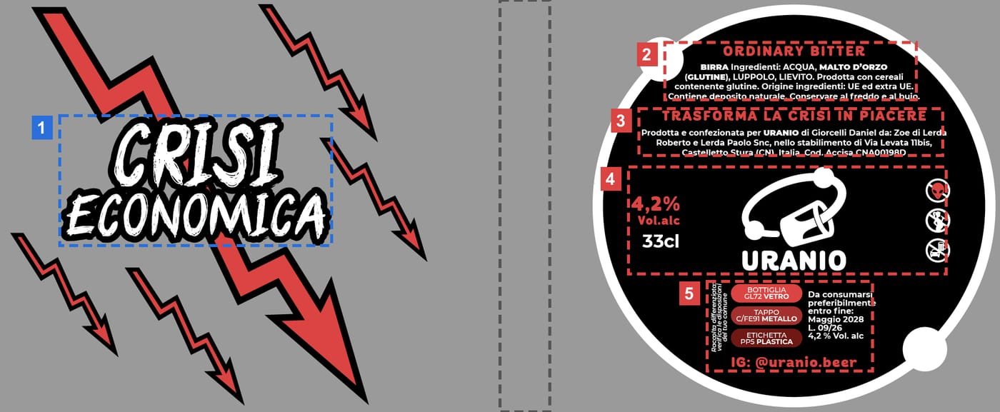

# Studio del modello 3D e confronto con ciaoenergy.com

Studio fatto il 2026-11-04, prima di rifare l'esperienza sul riferimento
<https://www.ciaoenergy.com/> (le schermate del proprietario, immagini
10–18). Tutte le misure sono rilette dal GLB vero in Node: la fonte di
verità del codice resta `src/config/bottle.ts`, e `npm run verify:glb` le
ricontrolla a ogni giro.

## Il modello

`public/models/crisi_economica.glb` (320 KB, dal sorgente
`assets-src/Crisi_Economica_etichettata.glb`): tre mesh, che
`prepareBottle()` porta in un unico spazio oggetto.

| mesh | cosa | misure (unità del modello, ≈ 21 cm in tutto) |
| --- | --- | --- |
| `vetro` | bottiglia ambra scura, due pareti | y 0,004 → 4,139; corpo r 0,656; spalla a ~2,35; collo r ≈ 0,31 da 2,45 a 3,75; anello del labbro r 0,335 a 3,8 |
| `tappo` | corona rossa zigrinata, 10 160 vertici | y 4,048 → 4,181, r 0,346, centro a 4,114 |
| `etichetta` | un'unica striscia avvolta, texture 2008 × 827 | y 0,455 → 1,733, r 0,651 (sta un filo dentro il vetro: si scala dell'1,2%) |

**Il tappo è una mesh a sé**, ed è questo che permette di staccarlo. Copre il
labbro del vetro per 0,09: alzato di un decimo è già libero.

## L'etichetta

La striscia gira attorno alla bottiglia per ~270°, in due pezzi con il vetro
nudo in mezzo (il riquadro grigio). La coordinata `u` della texture diventa
un angolo attorno all'asse (0° = verso la camera, positivo verso destra):

- **fronte** (u 0 → 0,5, da −57° a +78°): il logotipo "CRISI ECONOMICA"
  (riquadro 1, x 134–652 in pixel, cioè da −39° a +31°) su fondo trasparente,
  con i fulmini rossi. Con `rotation.y = 0` guarda la camera;
- **retro** (u 0,55 → 1, da 113° a 235°): il cerchio nero con i testi. Con
  `rotation.y = π` è centrato in camera.

L'altezza segue `y = 1,7327 − 1,2777 · v` (v = 0 è il bordo alto). Le quattro
fasce del retro, misurate in pixel e tradotte in altezza e arco:

| step | riquadro | pixel (y, x) | cosa c'è scritto | mezzo arco |
| --- | --- | --- | --- | --- |
| 2 | 2 | 85–200, 1335–1840 | ORDINARY BITTER, ingredienti | 34° |
| 3 | 3 | 218–312, 1283–1893 | TRASFORMA LA CRISI IN PIACERE, produttore | 41° |
| 4 | 4 | 335–550, 1262–1900 | 4,2% Vol.alc, 33 cl, marchio URANIO, pittogrammi | 43° |
| 5 | 5 | 565–745, 1420–1752 | raccolta differenziata, scadenza, IG @uranio.beer | 22° |

L'arco conta: la luce di una fascia deve inquadrare il suo blocco, e il
blocco della raccolta è largo la metà di quello degli ingredienti.

## Il confronto con il riferimento

Il riferimento ha più prodotti e più passi; noi abbiamo una birra e quattro
blocchi di testo. Quindi sette step, e ognuno corrisponde a un momento del
riferimento.

| riferimento | da noi | step |
| --- | --- | --- |
| 10–12: le lattine in cerchio, quella al centro fra il disco in alto e il piedistallo col nome; la faccia segue il mouse | l'anello di bottiglie, faro e piedistallo, il logotipo sul piedistallo; niente frecce né slider, perché la bottiglia è sempre la stessa | 0 |
| 13: primo piano della lattina inclinata, la faccia illuminata, nome e due righe a sinistra | primo piano della bottiglia, la faccia in alto a destra verso la luce, nome a sinistra | 1 |
| 14–16: la lattina al buio, un blocco di testo acceso per volta, tag barrato, titolo e testo a sinistra, icone a destra | lo stesso, sul retro, con il tappo che salta al primo step e resta sospeso | 2–5 |
| 17: tutte le lattine in fila curva | tutte le bottiglie in fila, il tappo che si richiude, "ZERO CRISI" e le call to action | 6 |

Dopo, a scroll nativo, le domande frequenti.

**Dove resta diverso, e perché:**

- una bottiglia non è una lattina: l'etichetta occupa solo il terzo basso, e
  un primo piano della faccia come il 13 lascia il collo fuori dal bordo
  alto. Il tappo, allo step dopo, entra in volo;
- il colore degli step è il rosso cupo della nostra etichetta, non il viola
  del gusto Double Litchi;
- nel finale, sotto la fila, ci sono le call to action e dietro una
  scritta "ZERO CRISI" tenue; il riferimento mostra solo la fila.

## Dove sta nel codice

| cosa | file |
| --- | --- |
| misure, fasce e mappature | `src/config/bottle.ts` |
| gli step (posa, camera, luce, tappo, mouse) | `src/config/keyframes.ts` |
| anello e fila | `src/core/Carousel.ts`, `src/config/beers.ts` |
| il volo del tappo | `src/core/Cap.ts`, `src/config/cap.ts`, `src/gl/Bottle.tsx` |
| il mouse | `src/core/Pointer.ts`, `src/config/pointer.ts` |
| la luce sulle fasce e sulla faccia | `src/gl/materials/patchBottle.ts` |
